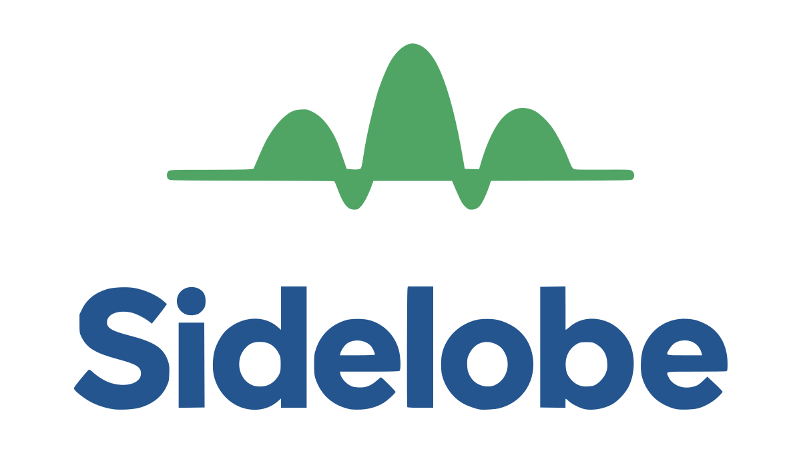

  

  <strong>Custom software and open-source developer tools.</strong> 
  Independent software studio · Europe

  <a href="https://sidelobe.dev">sidelobe.dev</a>
  ·
  <a href="mailto:hello@sidelobe.dev">hello@sidelobe.dev</a>

---

Sidelobe builds web applications, internal tools and automation for teams. We also publish developer tools that came out of problems we encountered while building and running software.

## Open source

### RuntimeTruth

A command-line tool for checking Codex runtime state against a reviewed baseline. It can compare model settings, permissions and instruction-file fingerprints, and optionally verify a baseline signed with Sigstore.

[PyPI](https://pypi.org/project/runtimetruth/) · [Project page](https://sidelobe.dev/open-source/runtimetruth/) · [Source](https://github.com/sidelobe-labs/runtimetruth) · [Releases](https://github.com/sidelobe-labs/runtimetruth/releases)

### PowerContract

Map signals from waveform CSV files, define voltage and timing checks in YAML, and run them against new captures. Each requirement reports PASS, FAIL or INDETERMINATE with its measured value and margin.

[Project page](https://sidelobe.dev/open-source/powercontract/) · [PyPI](https://pypi.org/project/powercontract/) · [Source and documentation](https://github.com/sidelobe-labs/powercontract)

## Working approach

For client work, start with the task people need to complete and agree on the first useful version. Test it with the people who will use it and document how it is deployed and maintained.

For public tools, keep the source, limitations, tests and release instructions available in the repository. Neither RuntimeTruth nor PowerContract requires a Sidelobe account or hosted service.

Open-source repositories have their own licenses and support policies. Publishing source code does not imply a hosted service or support agreement.

---

  <a href="https://sidelobe.dev">Website</a>
  ·
  <a href="https://github.com/sidelobe-labs">GitHub</a>
  ·
  <a href="mailto:hello@sidelobe.dev">Contact</a>

